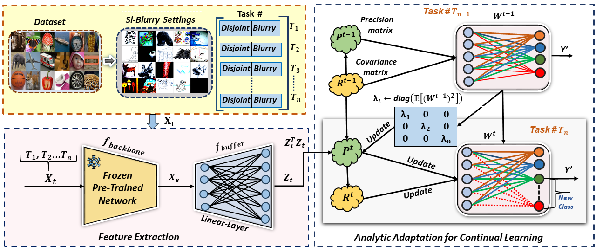

## Plasticity by Precision: Exemplar-free Analytic Adaptation for Continual Learning
We provide the complete codebase and pretrained models used to benchmark continual learning performance on three popular benchmark datasets for continual learning.
## Model
 

## Download Datasets
We conduct our experiments on the following datasets:
- [CIFAR-100](https://www.cs.toronto.edu/~kriz/cifar.html)
- [ImageNet-R](https://github.com/hendrycks/imagenet-r)
- [Tiny-ImageNet](https://www.kaggle.com/datasets/ambityga/tiny-imagenet)
  
Place the dataset file inside the ```local_datasets``` directory

## Download the Pretrained Backbone
We use a **DeiT ViT** backbone pretrained on 611 ImageNet classes (excluding 389 overlapping classes with CIFAR and Tiny-ImageNet to avoid data leakage) for all experiments.
The pretrained model is sourced from [CLOOD](https://github.com/k-gyuhak/CLOOD), 

Refer: Learnability and Algorithm for Continual Learning. ICML, 2023
**[Download DeiT ViT checkpoint.pth](https://drive.google.com/file/d/1uEpqe6xo--8jdpOgR_YX3JqTHqj34oX6/view?usp=sharing)**

### System Configuration
```
Python 3.12.3
Ubuntu 24.04.1 LTS
CUDA Version: 12.4
```
### Tain Model
```
Tested Model: [vit,resnet18,resnet34,resnet50,efficientnet_b0]
Tested Datset: [cifar100,tinyimagenet,imagenet-r]

**Run : python   aacl.py  --model_name <name> --dataset <name> --seed <value>**
```

## Acknowledgement 
